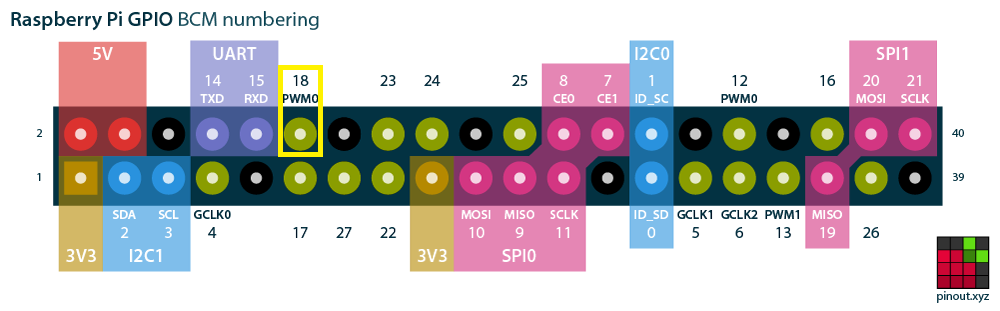

# Ping Pong Ball Clock

Raspberry Pi code for the Ping Pong Ball Clock Project

Author: PlanetaryMotion

---

## Video

https://www.youtube.com/watch?v=jIoWmhVCPb4&feature=youtu.be

## Inspiration

A reddit post originally tipped me off to the project. This [thingiverse](https://www.thingiverse.com/thing:4091854) project detailed some 3D printed parts for a ping pong ball clock. Upon further investigation I found an [instructable](https://www.instructables.com/id/Ping-Pong-Ball-LED-Clock/) project that laid out designs that did not involve 3D printing and optimized the LED placement. I used this instructable project as the basis for the hardware design. However, I knew from the start that I was going to control the clock using a raspberry pi (zero) and that I would build upon a previous project that controlled LEDs using a local web app.

## Software Design Concept

This firmware is centered in python because of how easy it is to use and a couple easy to use and essential libraries:

- Neopixel libraries
- Flask (web server)

The layout of the LED strips called for a font libraries and character writing functions to be written from scratch. This project only pulled from a previous project the code to be able to light up an LED. 

The the following images gave me a concept of how I was going to program the LED display with each vertical red line in the first image being an LED strip:


## Implementation

Font libraries and things related to the layout can be found in [Utils](code/Utils.py). 

The functions that drive almost every single part of the lighting and logic and display can be found in [LEDUtils](code/LEDUtils.py).

The [flaskUtils](code/flaskUtils.py) file contains all of the api views that respond to POST and GET requests from the web app.

Other things that serve the web app are found in [templates](code/templates/), [static](code/static/)

---
## Wiring

**WARNING: You may not have wired your LEDs like I did. This means that you will need to adjust the ledAdresses list in [Utils](code/Utils.py). How to do this and sort it out is described in this [issue](https://github.com/PlanetaryMotion/pingPongBallClock/issues/32).**

It is worth considering running a separate 5V power supply to power just the LEDs since you will be powering at least 128 of them. Then the only two wires that run to the raspberry pi from the LEDs are the data and ground wires. If you use a separate power supply, you must run a ground wire from the ground of the power supply to the raspberry pi ground so that logic is consistent, otherwise the LEDs will not light properly.  

Connect the data wire to BCM GPIO 18, physical header pin 12. This is how the code is set up currently. If you want to change the pin, make sure that you adjust the "LED_PIN" value in [Utils](code/Utils.py).

The ground wire can be run to any of the ground pins on the pi (black circles below). You can use the 5V pins to test short strands of LEDs but you **should not try to power the full length of LEDs with it. This has the potential to damage your pi.** Most noticible though, it will change the color of your LEDs throughout the strip because of the lack of power.



## Build

You must first make sure that git is installed on your Raspberry Pi so that you can clone the repo:

```sh
sudo apt-get update
sudo apt-get install --yes git
git clone https://github.com/PlanetaryMotion/pingPongBallClock.git
cd pingPongBallClock/code
./setup.sh
```

Run `setup.sh` as your regular login user, not with `sudo`. It asks for `sudo` only when installing the OS prerequisites and the service. The checkout path must use only ASCII letters, digits, `/`, `.`, `_`, and `-`. The script creates a project-local `.venv`, installs Flask, Requests, and `rpi-ws281x` there, then installs and starts a `systemd` service. This avoids installing Python packages into the system environment.

On the first run, setup prints the browser username and generated password. See [Sign in to the clock](#sign-in-to-the-clock) if you need to find or change them.

The service runs at boot and restarts after a crash. Its logs are available through the journal:

```sh
sudo systemctl status pingpongballclock
journalctl -u pingpongballclock -f
```

Useful service commands:

```sh
sudo systemctl restart pingpongballclock
sudo systemctl stop pingpongballclock
sudo systemctl disable --now pingpongballclock
```

The application uses the GPIO 18 PWM/DMA backend and therefore the service runs as `root`; HTTP Basic authentication sends credentials without encryption over plain HTTP. Use a trusted local network or Tailscale, and do not expose the web UI publicly. The installer generates the unit with the path to this specific checkout, so rerun `./setup.sh` after moving the repo or changing Python dependencies.

To run it manually for diagnosis, stop the service first, then use the project virtual environment:

```sh
sudo systemctl stop pingpongballclock
sudo ../.venv/bin/python main.py
```

Start the service again afterwards with `sudo systemctl start pingpongballclock`.

The webpage will be located at the local IP address of your Raspberry Pi and at port 5000. For instance, my local address for the clock was `192.168.1.22:5000`. If you need help finding the IP address of your Raspberry Pi, you can reference this [article](https://www.raspberrypi.org/documentation/remote-access/ip-address.md). I imagine that if you got this far, you can find it on your own though ;]

## Sign in to the clock

Open the clock's address in your browser. The initial username is `admin`. On the first run, `setup.sh` prints a unique password for your clock. There is no shared default password.

If you missed the password, run this command from the `pingPongBallClock/code` directory on the Raspberry Pi:

```sh
cat .local/auth.json
```

The file contains both your username and password. Keep it private. Rerunning setup does not change them.

To change the username or password, run:

```sh
python3 credentials.py
```

Press Enter to keep the current username, then enter the new password twice. The password does not appear as you type. The new credentials take effect immediately; your browser may ask you to sign in again. Run this command as the regular user that owns the checkout.

## Setup

The live board preview on the control page shows the colors currently commanded by the clock. Its brightness is an approximation and may look different from the physical LEDs. The preview reconnects when the clock becomes available again.

Changing the board type saves the selection and restarts the systemd service. Wait for the clock to reconnect, then refresh the page. If you run the program manually, start it again after changing the board type.

The default layout has 128 LEDs arranged in 7 rows and 20 columns. The settings section offers a larger layout. You can also change the text origin row and column, as well as how many lines are on screen to adjust the way the text displays. It is recommended that you have at least 10 rows to display two lines of text on the screen because the text fonts are 5 balls tall.

## Weather API Key (Required for weather content)

Before updating an existing installation to a version that removes the tracked legacy files, back up `code/settings.txt`, `code/webpagesettings.txt`, and `code/apikeys.txt`. The new service imports those files on its first launch if they are present.

Weather content requires an [OpenWeather API key](https://openweathermap.org/appid). On first launch, the application copies a legacy key from `code/apikeys.txt` into `code/.local/apikeys.json` if present. If no legacy key exists, the new file has an empty key. From the `code` directory, run `sudoedit .local/apikeys.json` and set your key:

```json
{"openweather": "YOUR_API_KEY"}
```

The service creates this file as root with owner-only permissions. After editing it, run `sudo systemctl restart pingpongballclock` so the service reads the new key. Keep the file private. The application stores settings in `code/.local/settings.json` and `code/.local/webpage.json`. The clock requests weather updates while weather content is active. Check your OpenWeather plan for its current limits.

## Usage

Please fork/clone this repo and make it your own. I would love to see some pull requests. This is a just a side hobby of mine so it may take me some time to get around to reviewing and merging. Also, FYI, not a developer IRL. This is just what I do for fun. Learning as I go. Feel free to contact me! 

## The Future

I plan on making more clocks, and adding more features as I go. I will even make a jumbo clock soon so the code should be designed to be able to fit to any clock size with some tweaking. 


### Presets and schedules

Save the current display under a name, apply or delete a preset, and optionally choose a startup default. Presets include display settings such as colors, content, brightness, weather location and line count. Board type, credentials and web page appearance are not included. A two-line preset requires an XL board. Finish any pending board change before applying a preset. Remove a preset's schedules and default selection before deleting it.

Schedules use the clock's local time and selected weekdays. The scheduler acts only when it observes the scheduled minute; it does not catch up after downtime or a forward clock jump. A nonexistent spring daylight-saving minute is skipped. A repeated fall minute runs at most once per schedule and local date, including after a restart or a backward clock adjustment. If several schedules are due at the same minute, the schedule with the lowest stable ID wins and all are recorded as run. A newly saved schedule matching the current minute is evaluated immediately. Failures are logged and shown on the controls page; a schedule blocked by a board restart is skipped rather than caught up later.

The startup default is applied on ordinary starts. A board configuration restart restores the saved active display instead. If a scheduled display was saved but not fully applied before an interruption, startup restores that saved display before returning to normal startup-default behavior on future starts. Presets and schedules are stored separately from active settings in the local state directory. The scheduler assumes a single clock service process.
